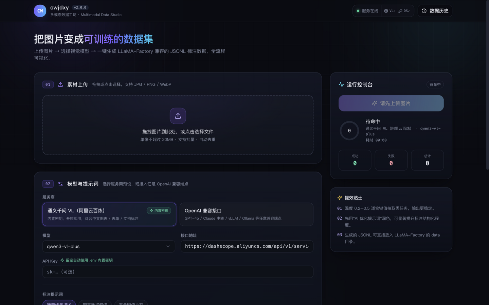
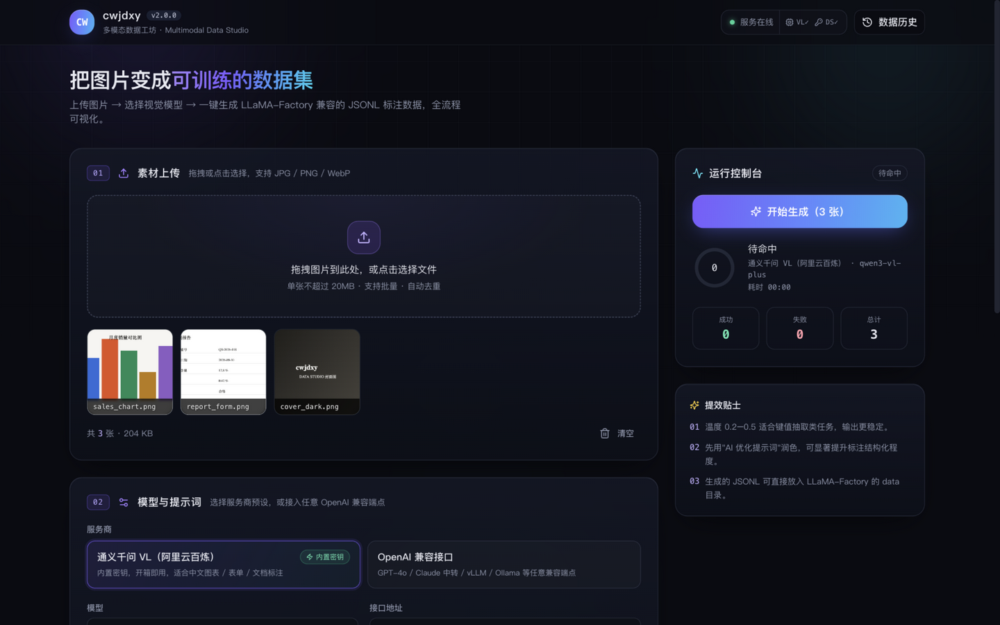
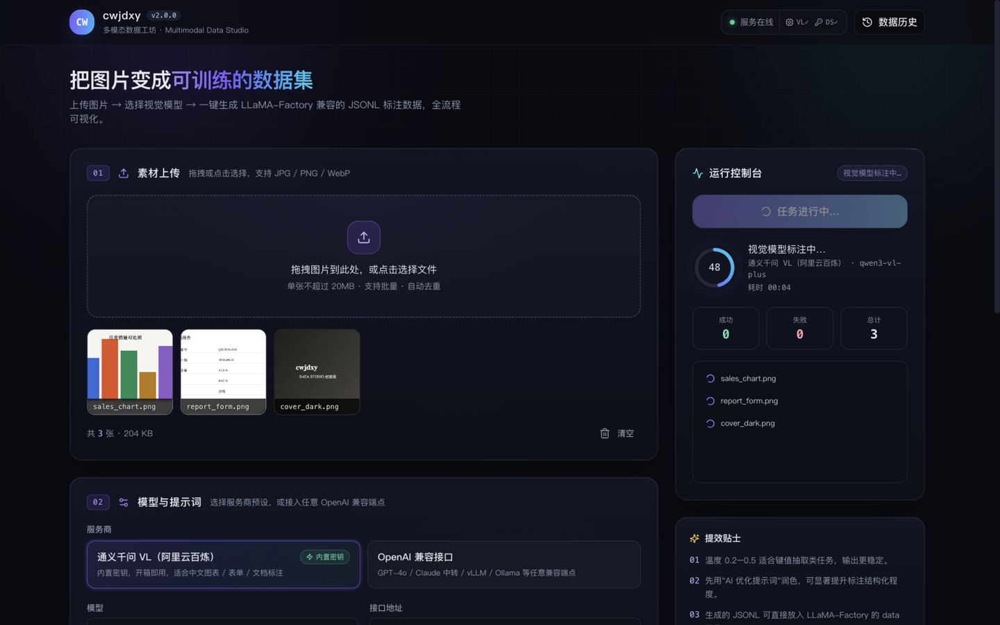
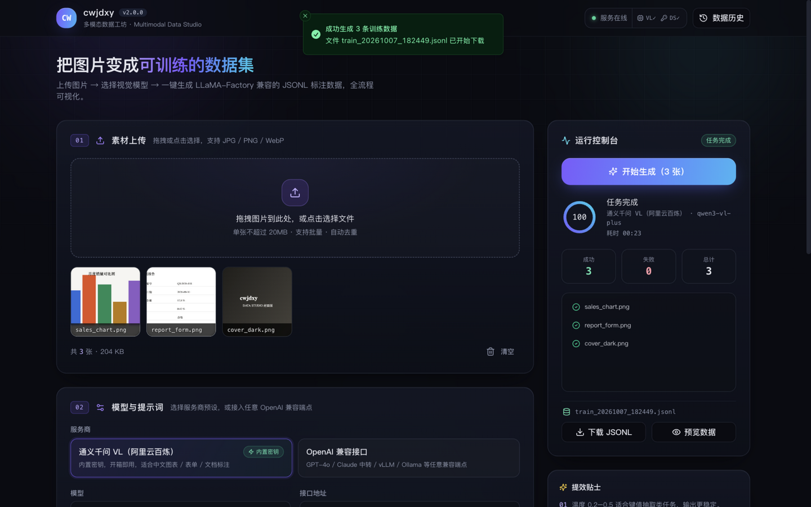
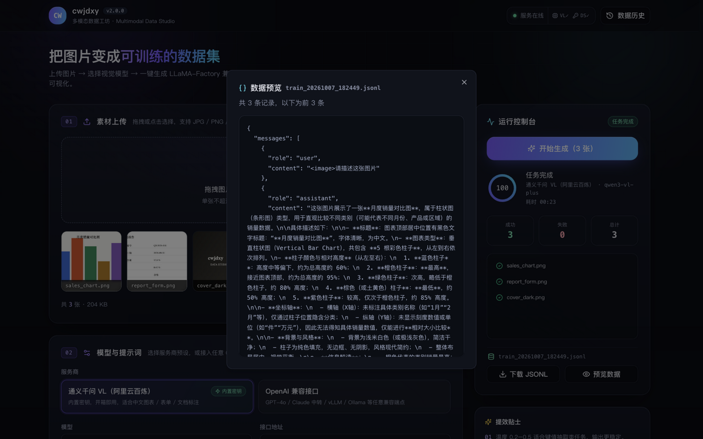
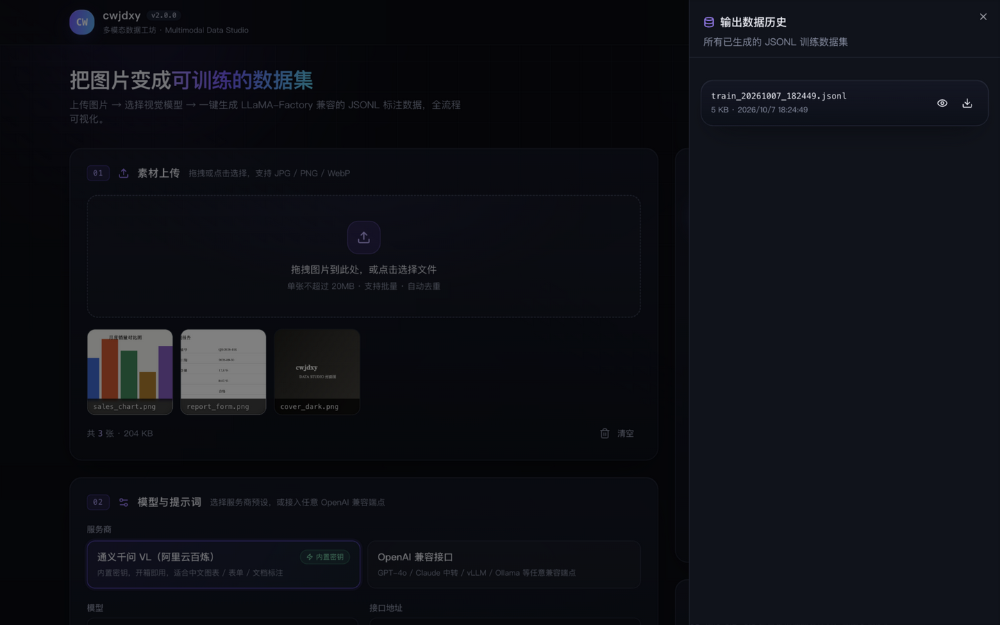

# cwjdxy 多模态数据工坊

<p align="center">
  
</p>

一个为多模态模型微调打造的数据标注工作台：上传一批图片，选好视觉模型与提示词，一键生成 **LLaMA-Factory 兼容的 JSONL 训练数据**。配置、标注、进度、结果、历史，全流程在一个页面里完成。


## 界面一览

| 素材上传与模型配置 | 生成进行中 |
| --- | --- |
|  |  |

| 任务完成 | 数据预览 |
| --- | --- |
|  |  |

<p align="center">
  <br/>
  <sub>输出数据历史：随时回看与重新下载</sub>
</p>

## 功能特性

- **服务商预设**：通义千问 VL（阿里云百炼）开箱即用，也可接入 GPT-4o / vLLM / Ollama 等任意 OpenAI 兼容端点
- **密钥自动回退**：前端密钥框留空时，自动使用 `backend/.env` 中配置的密钥
- **AI 提示词优化**：输入草稿提示词，调用 DeepSeek 润色为专业结构化标注提示词
- **场景化模板**：通用描述 / 图表数据解读 / 表单键值抽取，贴合垂直领域微调
- **运行控制台**：渐变进度环、成功/失败统计、逐张状态、耗时计时
- **数据预览与历史**：生成结果弹窗逐条检查，历史输出随时回看与重新下载
- **自动下载**：任务完成后 JSONL 自动保存到本地，同时纳入服务端历史

## 快速开始

### 环境要求

- Node.js 18+
- Python 3.8+

### 1. 启动后端

```bash
cd backend
bash start.sh        # Windows 使用 start.bat
```

后端运行在 `http://localhost:8000`，API 文档见 <http://localhost:8000/docs>。

### 2. 启动前端

```bash
npm install
npm run dev
```

浏览器打开 `http://localhost:3000`，顶栏显示「服务在线」即部署完成。

### 3. 生成第一批数据

1. 拖拽图片到上传区
2. 确认服务商与模型（默认通义千问 VL，使用 `.env` 内置密钥）
3. 选择提示词模板，点击「开始生成」
4. 完成后自动下载 JSONL，可点击「预览数据」检查内容

没有密钥时，可以运行 `bash start_demo.sh` 进入演示模式（模拟标注，不调用真实 API）。

## 环境变量

复制 `backend/.env.example` 为 `backend/.env` 并填入密钥：

| 变量 | 用途 |
|------|------|
| `DASHSCOPE_API_KEY` | 通义千问 VL 视觉标注（主通道） |
| `DEEPSEEK_API_KEY` | AI 提示词优化 |
| `TAVILY_API_KEY` | 预留 |
| `AMAP_MAPS_API_KEY` | 预留 |

## 输出格式

```json
{
  "messages": [
    { "role": "user", "content": "<image>请描述这张图片" },
    { "role": "assistant", "content": "该图表展示了……" }
  ],
  "images": ["chart_001.jpg"]
}
```

可直接放入 LLaMA-Factory 的 `data/` 目录，兼容 Qwen-VL 等主流多模态训练框架。

## API 一览

| 端点 | 方法 | 功能 |
|------|------|------|
| `/api/health` | GET | 健康检查（含密钥配置状态） |
| `/api/presets` | GET | 服务商预设 |
| `/api/upload` | POST | 上传图片（≤20MB/张） |
| `/api/generate` | POST | 批量标注并生成 JSONL |
| `/api/prompt/polish` | POST | DeepSeek 提示词优化 |
| `/api/preview/{filename}` | GET | 预览输出前 N 条记录 |
| `/api/download/{filename}` | GET | 下载输出文件 |
| `/api/outputs` | GET | 输出历史 |
| `/api/uploads/{filename}` | DELETE | 删除上传文件 |

## 项目结构

```
data_create/
├── backend/            # FastAPI 后端
│   ├── app.py          # 主服务
│   ├── demo_mode.py    # 演示模式
│   ├── .env.example    # 环境变量模板
│   └── start.sh / start.bat
├── src/                # React 前端
│   ├── App.tsx         # 工作台主界面
│   ├── index.css       # 设计系统（深空墨黑 + 极光紫青）
│   └── components/ui/  # 基础组件
├── docs/screenshots/   # 界面截图
└── vite.config.ts
```

## 常见问题

**顶栏显示「服务离线」？** 先启动后端：`cd backend && bash start.sh`。

**标注失败？** 检查 `.env` 中密钥是否有效、账户余额是否充足，并查看后端日志。

**生成的数据在哪？** 后端 `backend/outputs/` 目录，同时自动下载到本地，顶栏「数据历史」可随时重新下载。

## 许可证

[MIT](LICENSE) © cwjdxy
